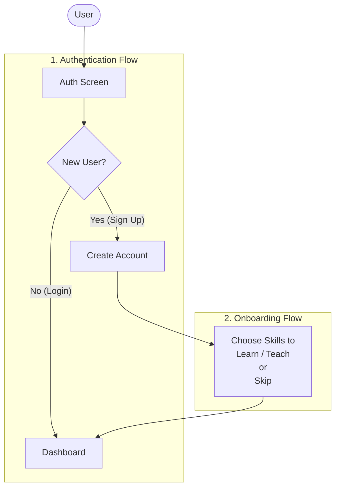

# SkillSwap

skillswap is a platform that let's exchange knowledge and skills together for free

## Overview

The core idea is make a platform which a user can look for an skill that they want to learn and teach skills that they know to others

This happens by an match engine that is based on this sentence **What i want, What they want**
the engine is has an state machine for its heart and the whole system has to do one thing: **Match the perfect user** for skill/knowledge exchange

## User flow

### Auth & On Boarding 

